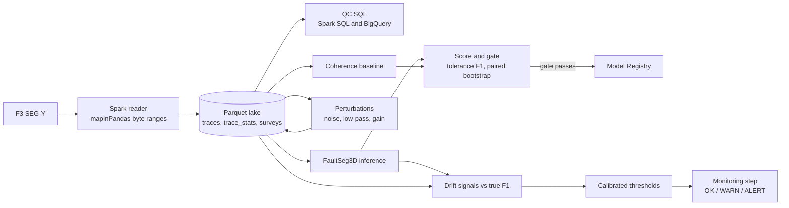

# seismic-fault-eval-pipeline

Evaluates and monitors a seismic fault-detection model: a PySpark and SQL data layer, tolerance-based evaluation with confidence intervals, a gated Kubeflow pipeline on GCP GEAP (Gemini Enterprise Agent Platform, formerly Vertex AI), and label-free drift monitoring calibrated against measured accuracy loss.

The model is the pretrained FaultSeg3D (Wu et al., 2019), run unchanged. The data is the public F3 survey (Netherlands), scored against one interpreter's picks of one fault on 41 inlines. The project measures and monitors a model; it does not train one.

## Main results

| Question | Answer |
|---|---|
| How good is FaultSeg3D on F3 against the picks? | F1 0.567, 95% CI [0.457, 0.652], at a 3-sample tolerance; 0.564 with the threshold chosen on separate inlines |
| Does it beat a classical baseline? | Yes: +0.353 F1 [0.213, 0.445] over semblance coherence on held-out inlines (paired block bootstrap). The baseline is a floor, not a strong competitor. |
| Does input drift mean accuracy loss? | No. A ×4 gain change maxes out amplitude PSI and changes F1 by nothing; normalized PSI then misses noise, which cost the most. |
| What does track accuracy loss, without labels? | The model's own output. Under noise it predicts up to 58% fewer fault voxels and F1 at the deployed threshold falls from 0.567 to 0.085, in the same order. |
| Does the tooling hold up on real data? | The Spark SEG-Y reader matches segyio on 600,515 traces; the metrics match an independent scoring script at every threshold; lake-based inference reproduces the SEG-Y run bit for bit. |

## Architecture



## Where each part runs

| Part | Local | GCP |
|---|---|---|
| SEG-Y reader, attributes, perturbations (PySpark) | Yes | Not yet: written to read `gs://` paths, not run on Dataproc |
| QC SQL | Spark SQL | BigQuery, run from a client |
| Evaluation pipeline: baseline, scoring, gate, register | `kfp local` | **Vertex AI Pipelines, succeeded 2026-11-08**; model registered |
| FaultSeg3D inference | Yes (CPU) | Not yet: the pipeline step stages precomputed predictions |
| Drift study | Yes | Not planned: a one-off experiment |
| Monitoring step | Spark SQL engine, `kfp local` | **Vertex AI Pipelines, succeeded 2026-11-11**, with input signals from BigQuery; schedules supported with a run cap |

## Components

| Area | Files | Verified by |
|---|---|---|
| SEG-Y → Parquet | `spark/segy_to_parquet.py` | F3: 600,515 traces, 18,586 missing positions, matching segyio; round-trip tests on synthetic IBM and IEEE files |
| Per-trace attributes, UDF timing | `spark/trace_attributes.py` | Python UDF 4.62 s, Arrow UDF 3.91 s, pandas UDF 0.90 s on 57,026 traces, identical results |
| QC SQL, two dialects | `sql/01–08`, `sql/bq/01–08`, `spark/qc_sql.py`, `gcp/qc_bq.py`, `gcp/load_bq.sh` | 8/8 planted-problem checks in Spark SQL and in BigQuery (`tests/check_qc.py`) |
| Metrics | `evaluation/fault_metrics.py`, `evaluation/score_f3.py` | 34/34 known-answer checks; matches `score_faults.py` on F3 |
| Baseline and gate | `baseline/coherence.py`, `evaluation/compare_models.py` | 16/16 checks, including exact semblance values and both gate outcomes |
| Evaluation pipeline | `pipeline/fault_eval_pipeline.py`, `Dockerfile`, `gcp/setup_vertex.sh`, `gcp/submit_pipeline.py` | 6/6 steps locally and on Vertex; gate-fail branch tested |
| Perturbations and inference from the lake | `spark/perturb.py`, `infer/faultseg_from_lake.py`, `scripts/perturbation_study.sh`, `scripts/fetch_f3_from_gcs.sh` | 10/10 checks; exact reproduction of the original predictions |
| Drift signals | `monitoring/drift_signals.py`, `sql/drift/`, `sql/drift/bq/` | 14/14 checks; on F3 noise 0.5 the BigQuery SQL gives raw PSI 4.58 against 4.57 from Spark SQL, and the same centroid shift (+9.8 Hz) |
| Monitoring | `monitoring/monitor_batch.py`, `monitoring/thresholds_f3.json`, `pipeline/monitor_pipeline.py`, `gcp/setup_monitor.sh`, `gcp/submit_monitor.py` | 16/16 checks; same status from the Spark and BigQuery engines; ran on Vertex |

## Results: pretrained FaultSeg3D on F3

Scored against one interpreted fault (`fault_0`) picked on 41 inlines (every 10th, 100–500).
Tolerance 3 samples; corridor = within 40 samples of a pick. No thinning.

| Threshold | Recall | Precision (all) | Precision (corridor) | Predicted px |
|---|---|---|---|---|
| 0.50 | 0.740 | 0.103 | 0.409 | 242,675 |
| 0.70 | 0.713 | 0.113 | 0.437 | 190,535 |
| 0.90 | 0.653 | 0.129 | 0.489 | 118,613 |

| Summary | Value |
|---|---|
| AP, all / corridor | 0.111 / 0.505 |
| Best F1 (corridor), t = 0.97 | 0.567, 95% CI [0.457, 0.652] (block bootstrap, 11 blocks of 4 inlines) |
| Held-out F1 (threshold chosen on alternate blocks) | 0.564 |
| Dice, pixel / dilated by 3, at t = 0.97 | 0.251 / 0.482 |

Reading:
- **Precision (all) is mostly a labeling-coverage number.** Only one of F3's many faults was picked, so other real faults count as false positives.
- **The best threshold is 0.97** because FaultSeg3D predicts bands several samples wide; a high threshold keeps only the band center. Thinning (`--thin`) does that explicitly.
- **Pixel Dice is half the tolerance-aware Dice** for the same prediction, so the metric definition has to be stated with any number.
- The table matches the earlier `score_faults.py` in seismic-fault-labeling exactly, as an independent check of `fault_metrics.py` on real data.

### Tolerance and thinning (same 41 inlines, corridor precision)

| Tolerance (samples) | Best F1, unthinned | Best F1, thinned (NMS) |
|---|---|---|
| 1 | 0.411 | 0.362 |
| 2 | 0.501 | 0.481 |
| 3 | 0.567 | 0.559 |
| 5 | 0.651 | 0.651 |
| 8 | 0.715 | 0.717 |

- **F1 rises steadily with tolerance, with no single jump**, which fits a spread of 1–8 sample offsets between the model's fault centers and the hand-drawn picks rather than one constant shift. Separating pick error from model error needs inter-interpreter agreement (e.g. CRACKS' multiple annotators).
- **Thinning cut predicted pixels 4.7×** but did not change F1 at practical tolerances; thinned F1 catches up by tolerance 5, so NMS is not breaking ridges. It costs a little F1 at tolerance 1–2, where the wide band covers a pick better than its center line does.
- **AP is not comparable between unthinned and thinned** (0.111 vs 0.058, all-section): thinning caps recall near 0.61, so the curves span different recall ranges. Compare F1 at an operating point instead.
- One tolerance hides all of this, so `score_f3.py --tol-sweep` reports F1 against tolerance.

### Gate: FaultSeg3D vs. a coherence baseline

Baseline: 1 − semblance (3 inlines × 3 crosslines × 9 samples, no dip steering), computed from the Parquet lake on the same crop.
Each model's threshold is chosen on 21 calibration inlines; the paired block bootstrap (5,000 draws) uses the other 20.

| Tolerance | FaultSeg3D F1 | Coherence F1 | F1 difference, 95% CI |
|---|---|---|---|
| 1 | 0.426 | 0.136 | 0.290 [0.168, 0.374] |
| 2 | 0.510 | 0.175 | 0.335 [0.195, 0.432] |
| 3 | 0.564 | 0.210 | 0.353 [0.213, 0.445] |
| 5 | 0.640 | 0.276 | 0.363 [0.236, 0.454] |
| 8 | 0.700 | 0.362 | 0.338 [0.228, 0.413] |

**Gate at tolerance 3: PASS** (lower bound 0.213 > 0; no bootstrap draw had the baseline ahead).

- Coherence's corridor precision stays near 0.12 at every threshold: it responds to dipping reflectors, noise and stratigraphic edges about as strongly as to faults (median attribute 0.24). FaultSeg3D's precision rises with threshold.
- **This baseline is a floor, not a strong competitor.** Beating it shows the model is useful, not that it is good; the gate's other conditions (no drop versus the registered model, minimum recall) carry the rest. A dip-steered, tuned and thinned semblance would be a fairer baseline.

### Drift study: which label-free signals track the F1 drop

Nine perturbed copies of the F3 crop, each run through FaultSeg3D and scored against the same picks (tolerance 3, corridor).
"F1 at 0.97" keeps the threshold chosen on clean F3, as a deployed model would; "best F1" re-chooses it per survey.

| Perturbation | Best F1 | F1 at 0.97 | Recall at 0.97 | Fraction of voxels > 0.5 | Spectral centroid shift | RMS PSI raw / normalized |
|---|---|---|---|---|---|---|
| None (F3) | 0.567 | 0.567 | 0.573 | 0.0343 | 0 | 0 / 0 |
| Gain ×4 | 0.567 | 0.567 | 0.573 | 0.0343 | 0 | 8.28 / 0.00 |
| Noise 0.25 × RMS | 0.505 | 0.487 | 0.423 | 0.0286 | +5.4 Hz | 0.35 / 0.00 |
| Noise 0.5 × RMS | 0.350 | 0.251 | 0.177 | 0.0208 | +9.8 Hz | 4.57 / 0.02 |
| Noise 1 × RMS | 0.220 | 0.085 | 0.050 | 0.0144 | +15.0 Hz | 8.28 / 0.13 |
| Low-pass 40 Hz | 0.567 | 0.567 | 0.585 | 0.0402 | −16.3 Hz | 8.04 / 0.27 |
| Low-pass 25 Hz | 0.521 | 0.521 | 0.559 | 0.0463 | −22.0 Hz | 8.28 / 0.66 |
| Low-pass 15 Hz | 0.482 | 0.481 | 0.549 | 0.0582 | −23.8 Hz | 8.28 / 1.19 |
| Time gain t¹ | 0.550 | 0.545 | 0.523 | 0.0315 | −2.7 Hz | 5.88 / 0.52 |
| Time gain t² | 0.487 | 0.465 | 0.402 | 0.0261 | −4.1 Hz | 8.28 / 0.99 |

Spearman correlation of each signal's size with the F1 drop at 0.97 (10 surveys, output signals from every inline): fragmentation **+0.91**, mean probability and fraction > 0.5 **+0.83**, entropy +0.76, centroid +0.47, normalized RMS PSI +0.41, dominant frequency +0.30, raw RMS PSI +0.25.

Findings:
- **Gain is a pure false alarm for input monitoring.** Raw RMS PSI hits its ceiling (8.28) and F1 is identical to four decimals, because the model normalizes each crop.
- **Normalizing the RMS statistic fixes the gain false alarm but misses noise**, the most damaging change (0.00–0.13), because white noise raises every trace's RMS in the same proportion. It also flags low-pass 40 Hz (0.27), which cost nothing.
- **Under noise the model goes quiet.** At the deployed threshold recall falls 0.57 → 0.05 while precision falls more slowly. Best-threshold F1 hides part of this: the best threshold moved from 0.97 to 0.01.
- **The model's own output is the best monitor.** When the fraction of voxels above 0.5 fell (noise, time gain), F1 fell in the same order: −8% → 0.02, −17% → 0.08, −24% → 0.10, −39% → 0.32, −58% → 0.48. When it rose (low-pass), F1 fell much less.
- **Direction matters for spectral shift**: a centroid rise tracked harm; a much larger fall mostly did not.
- **Noise fragments the predicted faults**: connected pieces per 1,000 fault pixels rose by 0.8, 2.2 and 3.5 with the three noise levels, and fell under low-pass and time gain. This signal is sensitive to sampling: computed on every 4th inline it showed almost nothing (see limits).

### Monitoring thresholds calibrated from the study

`monitoring/monitor_batch.py calibrate` sets a threshold at the midpoint of the gap between surveys that lost at least 0.05 F1 (WARN) or 0.15 F1 (ALERT) and those that did not. Signals whose harmed and unharmed surveys interleave are reported as context and never alert (`monitoring/thresholds_f3.json`).

| Signal | Direction | WARN | ALERT |
|---|---|---|---|
| Predicted fault fraction | Fall | 12.5% | 31.5% |
| Predicted fault fraction | Rise | 52.3% | none (no rise lost 0.15 F1) |
| Spectral centroid | Rise | 2.7 Hz | 7.6 Hz |
| Spectral centroid fall; RMS PSI raw and normalized | | context only | |

`check` on three study surveys: gain ×4 → OK (raw PSI 8.28 shown as context), noise 0.5 → ALERT on both rules (−39.3%, +9.8 Hz), low-pass 40 Hz → OK. These are the surveys the thresholds came from, so this shows the tool reports what the study found; it is not an independent validation.

Limits: 10 surveys, so the correlations are rough rankings (two surveys have zero drop and zero output shift, which lifts every output signal). Drops under about 0.1 are inside the bootstrap intervals. The perturbations keep the geology fixed; on a new area the fraction of predicted faults also changes for geological reasons, so the reference for that signal has to come from comparable data. The relation between predicted fraction and F1 was read from this table after the fact, not predicted. Output signals computed on every 4th inline differed from the whole crop (predicted fraction about 14% higher, fragmentation changes several times smaller); the cause has not been investigated, and all figures here use every inline.

## Limits and what is not done

- **Labels**: one interpreter, one fault, picked quickly. Whole-section precision is a coverage number; the corridor figures are the meaningful ones. A careful re-pick with every fault labeled on a few inlines is the next step, and would also allow calibration (ECE) to be measured.
- **Sample size**: 41 labeled inlines give intervals of about ±0.1 F1, and the drift study has 10 surveys.
- **Baseline**: semblance without dip steering, untuned.
- **Gate**: the checks against the currently registered model and a minimum recall are designed, not built.
- **Monitoring thresholds** come from one survey and synthetic perturbations with the geology held fixed, and have not been tested on a perturbation outside the calibration set.
- **Open question**: output signals computed on every 4th inline differed from the whole crop; not yet explained.
- **Not on GCP**: the Spark jobs (Dataproc) and FaultSeg3D inference as a pipeline step.
- **Scale**: F3 fits on one machine. Spark is used for the pattern, not out of need.
- **Tolerance** is in samples, treating one time sample and one trace as the same distance.

## References

- Wu, X., Liang, L., Shi, Y., Fomel, S. (2019). FaultSeg3D: using synthetic data sets to train an end-to-end convolutional neural network for 3D seismic fault segmentation. *Geophysics*.
- A large-scale benchmark on geological fault delineation models, arXiv 2505.08585.
- F3 Demo survey, provided by dGB Earth Sciences through the OpendTect Open Seismic Repository.

## Quick start (local, no cluster)

```bash
# PySpark 4 needs Java 17 or 21
sudo apt install openjdk-21-jre-headless
python3 -m venv venv && source venv/bin/activate
pip install -r requirements-spark.txt

# Self-test on a synthetic SEG-Y with known contents
python tests/make_synthetic_segy.py /tmp/syn.sgy
python spark/segy_to_parquet.py /tmp/syn.sgy --survey SYN --out /tmp/lake --master 'local[*]'
python tests/check_roundtrip.py /tmp/syn.sgy.truth.npz /tmp/lake/traces/survey=SYN
python spark/trace_attributes.py --root /tmp/lake --survey SYN --master 'local[*]'

# QC SQL on a survey with known problems: gaps, dead traces, duplicates, a 3x gain patch
python tests/make_synthetic_segy.py /tmp/qc.sgy --il 100,299 --xl 300,599 --ns 462 \
    --dups 25 --gain-patch 150,169,400,439,3
python spark/segy_to_parquet.py /tmp/qc.sgy --survey QC --out /tmp/lake --master 'local[*]'
python spark/trace_attributes.py --root /tmp/lake --survey QC --master 'local[*]' --variants pandas --repeat 1
python tests/check_qc.py /tmp/qc.sgy.truth.npz --root /tmp/lake --survey QC
python spark/qc_sql.py --root /tmp/lake --survey QC --master 'local[*]' --explain 08

# BigQuery (needs gcloud auth and Application Default Credentials)
pip install -r requirements-gcp.txt
bash gcp/load_bq.sh                       # LAKE=/tmp/lake by default
python gcp/qc_bq.py --survey QC
python tests/check_qc.py /tmp/qc.sgy.truth.npz --engine bq --survey QC

# Fault metrics (no Spark needed)
pip install -r requirements-eval.txt
python tests/check_metrics.py
python evaluation/fault_metrics.py --prob prob.npy --label label.npy --tol 2 --block 10
python tests/check_baseline.py

# F3: lake -> coherence baseline -> score both -> gate
# (F3 files come from seismic-fault-labeling: F3.sgy, inlines/, pred/)
L=~/devl/seismic-fault-labeling
python spark/segy_to_parquet.py $L/F3.sgy --survey F3 --out ~/lake --master 'local[*]' --driver-memory 16g
python baseline/coherence.py --lake ~/lake --survey F3 --crop $L/pred/crop.json --meta $L/inlines/meta.json --out ~/f3_coherence
python evaluation/score_f3.py --labels-dir $L/inlines --pred-dir ~/f3_coherence --tol 3 --tol-sweep 1 2 3 5 8
python evaluation/compare_models.py --labels-dir $L/inlines --pred-a $L/pred --pred-b ~/f3_coherence --tol 3 --tol-sweep 1 2 3 5 8 --out ~/f3_gate

# The same steps as a KFP pipeline, run locally (outputs under ~/kfp_local_outputs)
pip install -r requirements-pipeline.txt
python pipeline/fault_eval_pipeline.py local --repo-dir . --lake ~/lake --labels-dir $L/inlines \
    --faultseg-pred-dir $L/pred --weights-uri $L/models/fseg-70.hdf5
python pipeline/fault_eval_pipeline.py compile --out fault_eval_pipeline.yaml   # spec for GEAP

# Drift study (needs a TensorFlow venv in the labeling repo; DRIVER_MEM=6g on a 16 GB machine)
#   on a second machine, first: bash scripts/fetch_f3_from_gcs.sh
bash scripts/perturbation_study.sh

# Monitoring: thresholds from the study, then a label-free check of one batch
python monitoring/monitor_batch.py calibrate --drift-table ~/f3_study/drift_table.csv --out monitoring/thresholds_f3.json
L=~/devl/seismic-fault-labeling
python monitoring/monitor_batch.py check --root ~/lake --reference F3 --survey F3-noise-0.5 \
    --pred-dir ~/f3_study/F3-noise-0.5/pred --ref-pred-dir ~/f3_study/F3/pred \
    --thresholds monitoring/thresholds_f3.json --crop $L/pred/crop.json --meta $L/inlines/meta.json

# Monitoring on GEAP: input signals from BigQuery, optional schedule
bash gcp/setup_monitor.sh          # roles, trace_stats to BigQuery, predictions to GCS, image v2
IMG=us-central1-docker.pkg.dev/wx-modernization-0/seismic/fault-eval:v2
python gcp/submit_monitor.py --image $IMG --survey F3-noise-0.5 --wait
python gcp/submit_monitor.py --image $IMG --survey F3-noise-0.5 --schedule "TZ=America/Chicago 0 6 * * 1" --max-runs 3
python gcp/submit_monitor.py --list-schedules

# On GEAP (Vertex AI Pipelines): one-time setup, then submit
pip install google-cloud-aiplatform
bash gcp/setup_vertex.sh          # API, repo, service account, image (Cloud Build), F3 data to GCS
python gcp/submit_pipeline.py \
    --image us-central1-docker.pkg.dev/wx-modernization-0/seismic/fault-eval:v1 \
    --service-account seismic-pipeline@wx-modernization-0.iam.gserviceaccount.com
```
